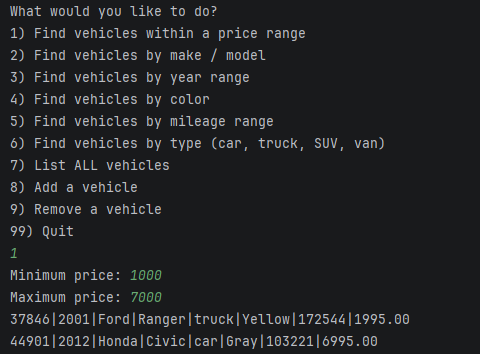
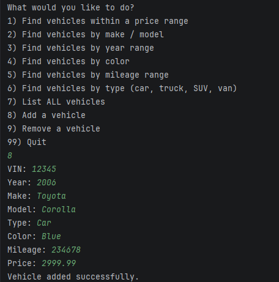
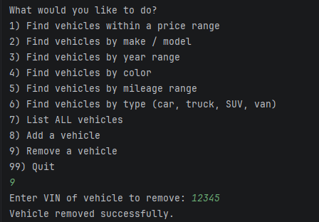

# Car Dealership Inventory Tracker App


## Description of the Project

This is a simple inventory app to keep track of different types of vehicles by reading a .csv file and displaying the data according to the user needs.

## Features

- Loads and stores new vehicle data into .csv files.
- Ability to add or remove vehicles.
- Can filter and display vehicles based on a number of parameters.

## User Stories

- As a dealership employee, I want to add a vehicle to the inventory, so that newly acquired vehicles are available for customers to view.
- As a dealership employee, I want to remove a vehicle from inventory, so that sold or unavailable vehicles no longer appear in search results.
- As a car shopper, I want to search for vehicles by price range, so that I can find vehicles that fit within my budget.
## Setup

### Prerequisites

- Java 17 (Amazon Corretto), the version used in class.
- IntelliJ IDEA Community Edition: <https://www.jetbrains.com/idea/download/>

### Running the application

1. Clone this repository, or download it as a zip and unzip it.
2. In IntelliJ: File > Open, pick the project folder (the one that holds `pom.xml`), press Open.
3. Wait for IntelliJ to finish indexing (progress bar at the bottom).
4. Open `src/main/java/com/pluralsight/YourMainClassName.java`. <!-- replace YourMainClassName with the class that has main -->
5. Right-click inside the file and choose Run 'YourMainClassName.main()'.

### Data and configuration

- `inventory.csv` sits at the project root, next to `pom.xml`. Contains prewritten transaction data. The program reads it at start.

## Technologies Used

- Java 17
- IntelliJ IDEA

## Demo







## A piece of code I am proud of

```java
public static Dealership getDealership() {
    try {
        FileReader fileReader = new FileReader("inventory.csv");
        BufferedReader bufferedReader = new BufferedReader(fileReader);

        String line;
        String[] dealershipParts = bufferedReader.readLine().split("\\|");
        Dealership dealership = new Dealership(dealershipParts[0], dealershipParts[1], dealershipParts[2]);

        while ((line = bufferedReader.readLine()) != null) {
            String[] parts = line.split("\\|");
            int vin = Integer.parseInt(parts[0]);
            int year = Integer.parseInt(parts[1]);
            String make = parts[2];
            String model = parts[3];
            String vehicleType = parts[4];
            String color = parts[5];
            int odometer = Integer.parseInt(parts[6]);
            BigDecimal price = new BigDecimal(parts[7]);

            Vehicle newVehicle = new Vehicle(vin, year, make, model, vehicleType, color, odometer, price);
            dealership.addVehicle(newVehicle);
        }
        return dealership;
    } catch (Exception e) {
        throw new RuntimeException(e);
    }
}
```
The piece of code I am most proud of is the getDealership() method. 
I like it because it combines several concepts that I learned throughout the project. 
It reads data from a CSV file, parses the data into the correct types, creates Vehicle objects, stores them in a Dealership object, 
and then makes that data available to the UserInterface class. 
Seeing all of these classes work together is very satisfying if I do say so myself.

## Future Work

- Allow users to have more than one dealership.
- Ability to use multiple filters at once.
- Ability to modify vehicle info.

## Resources


- Java YearUp Fall 2026 hub: <https://raymaroun.github.io/yearup-java-fall2026/>

## Author


- **Fabricio Leonel Baliño @ https://github.com/FabricioB44**

## Thanks

- Thank you to Raymond Maroun for guiding me with Java and pushing me to better document my code!